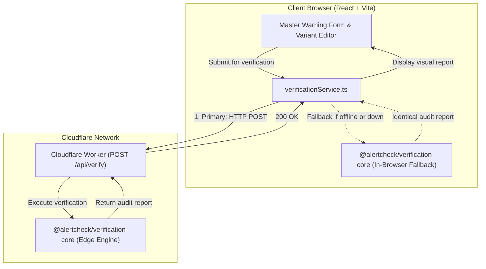

# AlertCheck

> **A free-tier, offline-capable critical-information integrity checker for emergency warnings**

[](https://github.com/your-org/alertcheck/actions)
[](https://opensource.org/licenses/Apache-2.0)
[]()
[]()

---

## 1. Problem Statement

Emergency warnings are frequently adapted across high-urgency channels (full press advisories, 160-character SMS broadcasts, and social media) and translated into multiple regional languages. During this high-stress process, critical information — such as affected sector boundaries, evacuation deadlines, safety restrictions, and emergency contact numbers — can be accidentally omitted, mistranslated, or fatally reversed.

**How might we help emergency communication teams verify that safety-critical information remains intact across translated and channel-adapted warning messages, using a structured source of truth and deterministic validation instead of depending on an external AI service?**

AlertCheck is a verification aid. It is **not** an official emergency-warning authority, an emergency dispatch service, or a replacement for qualified human reviewers.

---

## 2. Core Architectural Guarantees

AlertCheck operates strictly without:
- ❌ An external AI API key or proprietary LLM service
- ❌ A database or persistent storage dependency
- ❌ Paid cloud hosting fees
- ❌ Continuous internet access after initial asset loading
- ❌ Unattended algorithmic certification of safety

The core verification engine is **100% deterministic, testable, reproducible, and private**.

---

## 3. Architecture Overview

AlertCheck uses a shared TypeScript engine (`packages/verification-core`) shared between a Cloudflare Worker edge API (`apps/backend`) and a client-side React application (`apps/frontend`).



### Server and Client Parity
Because both the server and browser import the exact same npm workspace package (`@alertcheck/verification-core`), audit results are **bit-for-bit identical** whether verified in the cloud or during an offline network blackout.

---

## 4. Repository Structure

```
alertcheck/
├── apps/
│   ├── frontend/            # React 18, TypeScript, Vite, Tailwind CSS, Lucide React
│   │   ├── src/             # Master Warning Editor, Variant Generator, Audit Report
│   │   ├── tests/           # Vitest + React Testing Library integration tests
│   │   └── vite.config.ts   # Bundler config with path aliases
│   │
│   └── backend/             # Cloudflare Worker API (TypeScript)
│       ├── src/             # Fetch router, /api/health, /api/verify, CORS middleware
│       ├── tests/           # Vitest Worker integration tests
│       └── wrangler.jsonc   # Cloudflare Worker deployment configuration
│
├── packages/
│   └── verification-core/   # Shared deterministic verification engine
│       ├── src/
│       │   ├── types.ts     # Strongly typed domain models
│       │   ├── extractors/  # Time, quantity, and fact extractors
│       │   ├── validators/  # Location, deadline, quantity, action, prohibition checks
│       │   ├── templates/   # Template renderer (never silently deletes facts)
│       │   └── verification/# Verification pipeline & compare algorithms
│       └── tests/           # 23 unit tests covering all required edge cases
│
├── docs/
│   ├── architecture.md      # Detailed system architecture and diagrams
│   ├── verification-limitations.md # Linguistic boundaries and safety rules
│   └── deployment.md        # Cloudflare Pages & Workers deployment guide
│
├── .github/workflows/ci.yml # Automated CI for typecheck, test, and build
├── .gitignore
├── .env.example
├── package.json             # Root npm workspaces configuration
└── README.md
```

---

## 5. Quick Start & Local Setup

### Prerequisites
- Node.js v20 or v24
- npm v10 or higher

### Installation & Build
```bash
# Clone the repository
git clone https://github.com/your-org/alertcheck.git
cd alertcheck

# Install monorepo dependencies across all workspaces
npm install

# Build shared engine and applications
npm run build
```

### Running Locally
Open two terminal windows:

**Terminal 1 (Backend Cloudflare Worker):**
```bash
npm run dev:backend
# Starts Cloudflare Worker API on http://localhost:8787
```

**Terminal 2 (Frontend React Application):**
```bash
npm run dev:frontend
# Starts Vite development server on http://localhost:5173
```

Navigate to `http://localhost:5173` in your browser.

---

## 6. Automated Testing

All tests use explicitly labelled fictional demonstration data.

```bash
# Run all test suites across the monorepo (33 tests)
npm run test

# Run TypeScript type check across all packages
npm run typecheck

# Run production builds
npm run build
```

### Test Coverage Highlights:
- ✅ **Valid structured warnings**: Clean deterministic pass (`no_mismatch_detected`)
- ✅ **Empty / malformed inputs**: Schema validation failure (`issues_found`)
- ✅ **Missing locations**: Detects omitted affected areas (`critical`)
- ✅ **Missing deadlines**: Detects omitted evacuation times (`critical`)
- ✅ **Altered deadlines**: Detects changed times e.g. 18:00 to 20:00 (`critical mismatch`)
- ✅ **Altered quantities & contacts**: Detects modified telephone digits and sector numbers
- ✅ **Missing actions**: Detects omitted protective actions
- ✅ **Life-safety reversed prohibitions**: Detects dangerous stripped negations ("Do not drive" corrupted to "Drive through")
- ✅ **Message length overflow**: Detects SMS > 160 characters without silent truncation
- ✅ **Translation gate**: Flags demonstration Hindi variant for mandatory human review
- ✅ **Worker API integration**: Tests `GET /api/health` and `POST /api/verify`
- ✅ **Offline browser fallback**: Tests seamless switch when backend is unreachable

---

## 7. API Reference

The backend Cloudflare Worker exposes clean, structured JSON endpoints:

### `GET /api/health`
Returns service availability details without leaking internal secrets or environment paths:
```json
{
  "status": "healthy",
  "service": "alertcheck-api",
  "version": "1.0.0",
  "engine": "deterministic-rule-based",
  "offlineCapable": true,
  "requiresAiKey": false
}
```

### `POST /api/verify`
Validates a candidate message against a structured master warning.

**Request Body (`application/json`):**
```json
{
  "masterWarning": {
    "warningId": "warn-fic-flood-01",
    "hazardType": "Flash Flood",
    "severity": "emergency",
    "affectedAreas": ["River District", "Sector 4"],
    "issuedAt": "2026-10-12T12:00:00Z",
    "validUntil": "2026-10-12T22:00:00Z",
    "evacuationDeadline": "18:00",
    "requiredActions": ["Evacuate immediately to designated shelter"],
    "prohibitedActions": ["Do not drive through floodwater"],
    "safetyContact": "Helpline: 1800-555-0199",
    "sourceReference": "Civil Defense Bureau",
    "sourceVersion": 1
  },
  "candidateText": "EMERGENCY: Flash Flood in River District. Evacuate by 20:00.",
  "format": "full",
  "language": "en"
}
```

**Response (`200 OK`):**
```json
{
  "reportId": "rep-k98...-f7a",
  "warningId": "warn-fic-flood-01",
  "status": "issues_found",
  "verifiedAt": "2026-10-12T16:00:00.000Z",
  "engineMode": "cloudflare_worker",
  "summary": {
    "totalFindings": 3,
    "criticalCount": 3,
    "warningCount": 0,
    "infoCount": 0,
    "requiresHumanReviewCount": 3
  },
  "findings": [
    {
      "id": "loc-missing-1",
      "category": "location",
      "severity": "critical",
      "explanation": "Critical location omitted: \"Sector 4\" is declared in the source warning but was not found in the candidate message.",
      "sourceEvidence": "Affected Area: Sector 4",
      "candidateEvidence": null,
      "status": "missing",
      "requiresHumanReview": true
    },
    {
      "id": "deadline-evac-mismatch",
      "category": "deadline",
      "severity": "critical",
      "explanation": "Changed evacuation deadline: Source specifies \"18:00\", but candidate message specifies conflicting time \"20:00\".",
      "sourceEvidence": "Source Deadline: 18:00",
      "candidateEvidence": "Found in candidate: \"20:00\"",
      "status": "mismatch",
      "requiresHumanReview": true
    }
  ],
  "disclaimer": "AlertCheck is an automated verification aid and NOT an official emergency-warning authority...",
  "metadata": {
    "sourceHazard": "Flash Flood",
    "candidateFormat": "full",
    "candidateLanguage": "en",
    "characterCount": 61,
    "characterLimit": 4000
  }
}
```

---

## 8. Deployment (Free Tier)

AlertCheck deploys on 100% free-tier services:
- **Frontend**: Cloudflare Pages (`apps/frontend/dist`, command `npm run --workspace=@alertcheck/frontend build`)
- **Backend**: Cloudflare Workers (`npm run --workspace=@alertcheck/backend deploy`)

For step-by-step deployment instructions, see [docs/deployment.md](docs/deployment.md).

---

## 9. Security & Privacy Safeguards

- **Zero Logging of Message Drafts**: In-memory ephemeral processing only. No databases, persistent disk caches, or external analytical trackers.
- **No Third-Party AI Leakage**: Emergency warning text is never transmitted to commercial AI providers.
- **Strict Size Limits**: Request payloads are limited to 64 KB to mitigate DoS attacks.
- **Explicit Human Gate**: All reports include non-authority disclaimers and human-review requirements.

---

## 10. Verification Limitations

Deterministic pattern matching cannot certify arbitrary natural language as semantically equivalent. For detailed documentation on language handling and why commercial LLMs were omitted from the verification loop, refer to [docs/verification-limitations.md](docs/verification-limitations.md).

---

## 11. License

Apache License 2.0. Open source for public safety and emergency communications research.
