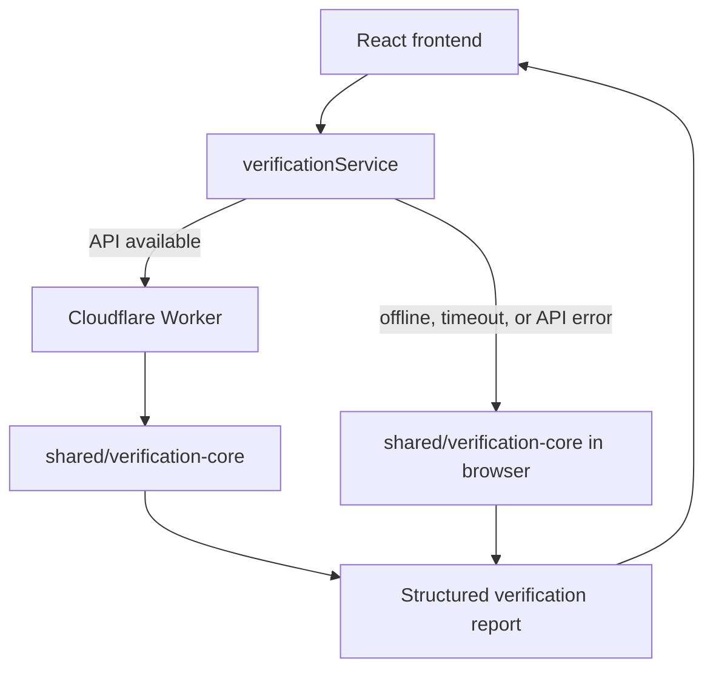

# AlertCheck System Architecture

## 1. Purpose

AlertCheck is an experimental critical-information integrity checker for structured emergency warnings and their channel-adapted variants. It helps a human reviewer identify supported mismatches in locations, deadlines, quantities/contact numbers, required actions, prohibitions, validity data, and message length.

It does not certify arbitrary translations, issue official warnings, or replace an authorized human reviewer.

## 2. Repository structure

```text
alertcheck/
├── architecture/                 # Product and engineering rules; API and deployment contracts
├── frontend/                     # React + TypeScript + Vite user interface
│   ├── src/
│   │   ├── components/           # Shared visual components
│   │   └── features/             # Warning authoring and verification UX
│   ├── public/                   # Static assets and service worker
│   └── tests/                    # Frontend and fallback tests
├── backend/                      # Cloudflare Worker HTTP API
│   ├── src/routes/               # /api/health and /api/verify
│   ├── src/middleware/           # CORS and safe error handling
│   ├── src/lib/                  # Request/response helpers
│   └── tests/                    # Worker/API tests
├── shared/
│   └── verification-core/        # Shared domain types, rules, renderer, tests
├── diff/                         # Restructure patch and migration notes
├── .github/workflows/ci.yml      # CI checks
├── package.json                 # npm workspaces and root commands
└── README.md
```

## 3. Runtime architecture



Both environments use the same shared verification rules. The report's `engineMode` distinguishes `cloudflare_worker` from `browser_local`. Because runtime metadata can differ, report timestamps/IDs are not expected to be byte-identical; the substantive findings should match for the same request.

## 4. Module responsibilities

### `frontend/`

- Collects and displays the structured master warning.
- Generates/edit candidate variants using the shared template renderer.
- Calls the Worker when configured and available.
- Falls back to local deterministic verification if the API request fails.
- Displays findings, evidence, status and human-review requirements.
- Registers the existing service worker in production for static shell caching. Reopening offline must be tested before claiming it works in all browsers.

### `backend/`

- Exposes health and verification endpoints.
- Parses JSON and enforces a request body size limit.
- Calls the shared verifier with `engineMode: cloudflare_worker`.
- Applies configured CORS headers and safe error responses.
- Does not persist submitted message content.

### `shared/verification-core/`

- Owns domain types and request schema validation.
- Extracts explicitly supported critical facts.
- Renders deterministic templates.
- Validates location, deadline, quantity, action, prohibition, and length conditions.
- Aggregates findings into a report.
- Contains unit tests for the rules.

### `architecture/`

Defines the non-negotiable product rules, the verifier's boundaries, the API contract, deployment process, and test expectations. Changes to behaviour must keep the rules and tests synchronized.

## 5. Pipeline

1. Validate the request structure and master warning.
2. Select the format-specific character limit.
3. Add the human-review gate for a Hindi demonstration variant.
4. Run location, deadline, quantity/contact, required-action and prohibition checks.
5. Calculate finding counts and the overall status.
6. Return a structured report with evidence and a non-authority disclaimer.

## 6. Shared-package build ordering

The `shared/verification-core` package exports compiled files from `dist/`. Therefore, commands that type-check, test, or build consumer workspaces must build the shared package first. Root npm scripts enforce this. The frontend Vite alias points to shared source for bundling; TypeScript/package resolution still relies on the package's generated declarations.

Never deploy the frontend or Worker from a clean checkout using a command that skips building the shared package.

## 7. Operational boundaries

- No database is needed in the initial version.
- No AI provider is needed for the core verification path.
- Free-tier hosting is a deployment goal, not a guarantee of permanent uptime.
- No automatic publication or dispatch is implemented.
- Human approval is mandatory for all real-world use.
