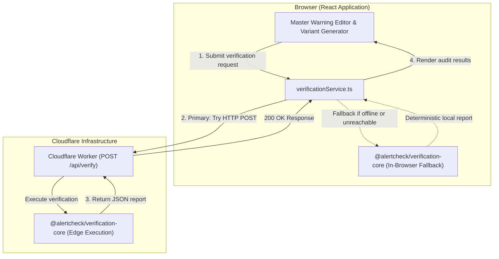

# AlertCheck Architecture & System Design

## 1. System Overview

**AlertCheck** is a free-tier, offline-capable critical-information integrity checker for emergency warnings. It assists emergency communication teams in ensuring that safety-critical facts (affected locations, deadlines, required actions, prohibitions, and telephone numbers) remain preserved across translated and channel-adapted messages prior to broadcast.

### Core Product Principle
The application operates without:
- An external AI API key or proprietary LLM service
- A database or persistent data store
- Paid hosting infrastructure
- Continuous internet connectivity after static asset loading

Verification is **100% deterministic, testable, reproducible, and private**.

---

## 2. Monorepo Structure & Workspaces

AlertCheck is architected as an npm-workspaces monorepo:

```
alertcheck/
├── apps/
│   ├── frontend/            # React 18, TypeScript, Vite, Tailwind CSS, Lucide React
│   │   ├── src/             # UI components, features, hooks, offline services
│   │   ├── tests/           # Vitest + React Testing Library integration tests
│   │   └── vite.config.ts   # Bundler config with path aliases
│   │
│   └── backend/             # Cloudflare Worker API (TypeScript)
│       ├── src/             # Fetch handler, routes (/api/health, /api/verify), CORS
│       ├── tests/           # Vitest API integration tests
│       └── wrangler.jsonc   # Cloudflare Worker deployment configuration
│
├── packages/
│   └── verification-core/   # Shared deterministic verification engine
│       ├── src/             # Domain types, schemas, extractors, validators, templates
│       ├── tests/           # Vitest unit test suite (23 unit tests)
│       └── tsconfig.json    # Emits ESM & types for consumption
│
├── docs/                    # Architecture, limitations, and deployment docs
└── .github/workflows/ci.yml # Continuous Integration pipeline
```

---

## 3. High-Level Architecture & Parity Flow

Both the Cloudflare Worker backend and the React frontend import the **identical verification logic** from `@alertcheck/verification-core`.



---

## 4. Verification Engine Pipeline

When `verifyWarning(request)` is invoked, it executes the following deterministic stages:

1. **Schema & Validity Validation**: Verifies that the structured master warning has non-empty fields, valid ISO 8601 timestamps, and consistent time windows (`validUntil > issuedAt`).
2. **Channel Length Constraint**: Evaluates character counts against target formats (SMS: 160 chars, Social: 280 chars). Crucially, AlertCheck **never silently truncates facts** to fit limits; it flags an explicit delivery warning.
3. **Location Preservation**: Audits each entry in `masterWarning.affectedAreas`. Identifies missing areas (Critical) and unknown areas.
4. **Deadline Verification**:
   - Parses time strings (12-hour AM/PM, 24-hour military, ISO timestamps) into minutes from midnight.
   - Verifies whether the evacuation deadline is present.
   - Detects altered deadlines (e.g., 18:00 corrupted to 20:00).
5. **Quantity & Contact Integrity**:
   - Compares emergency telephone numbers, sector numbers, and quantitative measurements.
   - Flags altered numbers as critical mismatches to prevent misdirecting the public.
6. **Required Action Verification**:
   - Evaluates mandatory protective instructions (e.g., "Evacuate immediately", "Move to higher ground").
   - Categorizes verbatim preservation, omissions (Critical), and rephrasings (Needs Human Review).
7. **Reversed Prohibition Detection**:
   - Evaluates negative commands (e.g., "Do not drive through floodwater").
   - Analyzes clause boundaries to confirm that negative polarity particles ("do not", "never", "avoid", "मत", "न") precede the prohibited hazard.
   - Flags stripped negations as an extreme **Critical Safety Hazard**.
8. **Language Review Gate**:
   - Flags demonstration non-English variants (e.g., Hindi) with mandatory human reviewer gates.

---

## 5. Security & Privacy Safeguards

- **Zero Data Persistence**: Neither the frontend nor the Cloudflare Worker stores submitted messages in databases or server logs.
- **Strict Size Limits**: Request bodies are capped at 64 KB to eliminate DoS risk on the serverless edge.
- **Zero Third-Party AI Data Leaks**: Sensitive emergency communications drafts are never transmitted to external commercial LLM APIs.
- **CORS Protection**: Access is restricted to allowed origins in production environments.
